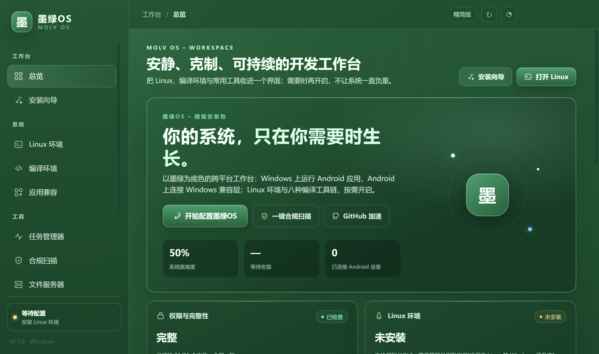

# 墨绿OS · MolvOS

> 把 Linux、编译环境与常用工具，收进一个安静的工作台。



墨绿OS 是一个以 **#2A603B** 为主色的跨平台开发工作台，提供 Windows、Android、Linux 三个版本。它把 Linux 运行时、八种语言的编译环境、任务管理器、本地合规扫描、只读文件服务器、GitHub 下载加速与启动盘制作器放进同一个中文界面。

> **重要说明**：墨绿OS 不是从零编写的 Linux 内核或发行版，也不把 APK “变成” Windows 原生程序。它负责检测、安装、编排与解释已有的运行时（WSL2 / chroot / Termux / Winlator / Wine / Android 模拟器），并明确展示每一步的能力边界。

## 功能

- **Windows / Linux / Android 三端**：同一套墨绿界面，各平台使用本地原生服务。
- **Linux 环境**：Windows 使用 WSL2 + Alpine；Android root 使用 chroot + Alpine；Linux 使用原生 shell 或 Alpine rootfs。
- **八种编译环境**：C/C++、Python、Java、Node.js、Go、Rust、PHP、Ruby；可作用于整机或 Linux 环境，按需开启。
- **首次运行向导**：权限检查 → 文件完整性（SHA-256）→ 虚拟化检测 → 安装 Linux 环境。
- **应用兼容**：Windows 端通过 adb 安装 APK 到真机/模拟器；Android 端检测 root 与 Winlator。
- **任务管理器**：进程、CPU、内存、结束进程（系统关键进程保护）。
- **合规扫描**：按本地策略检索敏感凭据、可执行脚本与超大文件；隔离而不是直接删除；不构成法律判断。
- **文件服务器**：只读 HTTP 服务、目录索引、局域网地址、可选 UPnP 端口映射。
- **GitHub 加速**：可切换社区镜像、测速、改写下载链接、可选写入 git `insteadOf`。
- **启动盘制作器**：检测可移动磁盘、选择 ISO、文件复制 / RAW 直写、确认短语与管理员检查。
- **中文 GUI + CLI**：`molv` 命令行支持状态、检查、扫描、文件服务器、GitHub 测速等。
- **持久化**：配置原子写入、备份文件、窗口状态、最近页面、日志轮转。

## 下载与安装

构建产物位于 `dist/`：

| 平台 | 文件 | 说明 |
| --- | --- | --- |
| Windows | `MolvOS-0.1.0-Portable.exe` | 便携版，双击运行，无需安装 |
| Windows | `MolvOS-0.1.0-win-x64.zip` | 解压即用，适合审计或自行打包 |
| Android | `MolvOS-0.1.0-android.apk` | Android 8.0+，WebView 原生桥接 |
| Linux | `MolvOS-0.1.0-linux-x64.tar.gz` | 解压后运行 `molv-os` |
| Linux | `molv-os_0.1.0_amd64.deb` | Debian / Ubuntu 安装包 |
| 校验 | `SHA256SUMS.txt` | 所有发布文件的 SHA-256 |

Windows 首次运行会在数据目录创建配置；如果系统限制 AppData 写入，会自动退回到程序目录的 `MolvOS-Data`。

## 快速开始

1. 打开墨绿OS，进入「安装向导」。
2. 点击「一键检查」，查看权限、完整性与虚拟化状态。
3. 点击「安装 Linux 环境」：
   - Windows 需要 WSL2（首次安装会请求管理员权限，可能要求重启）。
   - Android 需要 root；未 root 可使用 Termux + proot-distro。
   - Linux 可直接使用原生 shell，或安装 Alpine rootfs 获得隔离环境。
4. 在「编译环境」选择作用域（整机 / Linux 内），开启需要的语言。
5. 进入「Linux 环境」打开终端，或使用快捷命令。

## 开发与构建

```bash
npm install
npm run start              # 开发模式
npm run make:integrity     # 生成完整性清单
npm run dist:win           # Windows NSIS + Portable
npm run dist:linux         # Linux tar.gz
npm run build:android      # 需要 Android SDK，见下
```

Android 构建需要：

- JDK 17+（`javac`、`jar`、`keytool`）
- Android SDK Build-Tools 35.0.0
- Android Platform 35（`android.jar`）

默认在 `.sdk/` 下查找；也可以修改 `android/build-apk.ps1` 中的 `$sdk` 与 `$jdk`。

## 目录

```
src/main/            Electron 主进程、IPC、本地能力
src/renderer/        共享 Web 界面（桌面与 Android WebView）
android/             原生 Android 工程与 APK 构建脚本
cli/                 molv 命令行
docs/                说明书、架构、安全、宣传与发布文档
scripts/             完整性清单、图标等构建脚本
```

## 能力边界

| 需求 | 实现方式 | 限制 |
| --- | --- | --- |
| Windows 运行 APK | adb + Android 真机/模拟器 | 不是 Windows 原生执行；需 Android 运行时 |
| Android 运行 Windows 程序 | Winlator / Wine + Box64 | 兼容性取决于应用；需另装 Winlator |
| Linux 环境 | WSL2 / chroot / proot / 原生 | Windows 无 WSL2 时无法启动 Linux |
| 编译环境 | winget / apk / 系统包管理器 | 安装第三方工具可能要求管理员权限 |
| 端口映射 | UPnP | 路由器需开启 UPnP；失败不影响局域网访问 |
| 启动盘 | RAW / FAT32 文件复制 | 会擦除目标盘；需管理员权限 |
| 合规扫描 | 本地规则匹配 | 不构成违法性认定，不上传文件 |

## 安全

- 所有破坏性操作都要求显式确认；启动盘写入需要输入 `ERASE <磁盘号>`。
- 扫描命中文件移动到隔离区（vault），不直接删除。
- 不申请相机、麦克风、定位权限。
- 默认不上传遥测；GitHub 加速只处理公开链接。
- 第三方镜像、Wine、Winlator、Android 模拟器均有各自的安全边界，请自行评估。

详见 [SECURITY.md](docs/SECURITY.md)。

## 许可证

MIT License。Windows、Android、Linux 是其各自权利人的商标；本项目与 Microsoft、Google、Linux 基金会无隶属关系。

## 链接

- 使用说明书：[docs/MANUAL.md](docs/MANUAL.md)
- 技术架构：[docs/ARCHITECTURE.md](docs/ARCHITECTURE.md)
- 宣传文案：[docs/MARKETING.md](docs/MARKETING.md)
- 发布说明：[docs/GITHUB_RELEASE.md](docs/GITHUB_RELEASE.md)
