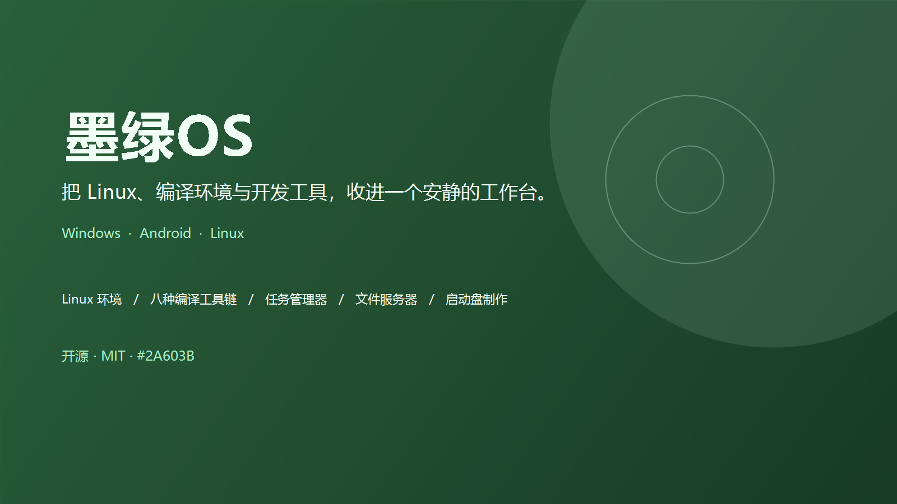

# 墨绿OS 宣传文案

## 一句话

**墨绿OS：把 Linux、编译环境与开发工具，收进一个安静的工作台。**

## 短文案（应用商店 / 社交媒体）

你有没有过这样的时刻：为了跑一段 Python，装了三个运行时；为了编译一个 C++ 文件，翻了十页教程；为了传一个文件，打开了一个带广告的网盘。

墨绿OS 想把这些事收进一个界面：Linux 环境、八种编译工具链、任务管理器、文件服务器、 GitHub 加速、启动盘制作。需要时开启，不需要时安静待命。

主色 #2A603B。Windows / Android / Linux 三端。开源，MIT。

## 长文案

墨绿OS 是一个跨平台开发工作台，而不是又一个“全能系统”的承诺。

它把复杂留给自己：

- Windows 上，用 WSL2 跑 Alpine，用 adb 把 APK 安装到真机或模拟器；
- Android 上，root 后用 chroot 跑 Alpine；没有 root，就诚实地告诉你 Termux 的路径；
- Linux 上，直接用原生 shell，或安装隔离的 rootfs。

它把选择留给你：

- 八种语言，不需要全部开启；
- 整机作用域或 Linux 内作用域；
- 全量、精简、极简三种安装规格；
- 只读文件服务器，开或不开。

它把边界说清楚：

- APK 不是 Windows 原生程序；
- Wine 不是 Windows；
- 合规扫描不是法律判断；
- 社区镜像不是官方服务。

墨绿OS 的界面以 #2A603B 为底，安静、克制、不打扰。没有弹窗广告，没有后台挖矿，没有未经同意的安装。

## 功能子弹

- Linux 环境：WSL2 / chroot / proot / 原生，按平台选择
- 八种编译环境：C/C++、Python、Java、Node.js、Go、Rust、PHP、Ruby
- 首次运行向导：权限 → 完整性 → 虚拟化 → Linux
- Windows 安装 APK：adb + 真机/模拟器
- Android 运行 Windows 程序：Winlator 检测与跳转
- 任务管理器：进程、CPU、内存、关键进程保护
- 合规扫描：敏感凭据、脚本、超大文件；隔离而非删除
- 文件服务器：只读、目录索引、局域网地址、UPnP
- GitHub 加速：镜像测速、链接改写、可选 git 配置
- 启动盘制作：USB 检测、RAW/FAT32、确认短语
- 中文 GUI + CLI
- 配置原子写入、备份、日志轮转

## 标语备选

1. 你的系统，只在你需要时生长。
2. 把复杂收进墨绿。
3. 安静工作，按需生长。
4. 一个界面，三种系统，八种语言。
5. 不假装全能，只把能做的做好。

## 社交平台版本

### 微博 / 小红书（短）

**墨绿OS 0.1.0 发布了。**

一个 #2A603B 的跨平台工作台：Windows 跑 APK、Android 跑 Linux、八种编译环境按需开启，还有任务管理器、文件服务器、GitHub 加速和启动盘制作。

不是“全能系统”，是把运行时、工具链和安全边界整理清楚的开源项目。MIT。

#墨绿OS #开源 #Linux #开发工具

### X / Twitter（英文）

Meet MolvOS 0.1.0 — a quiet, dark-green (#2A603B) workspace for Linux, eight toolchains, Android APKs on Windows, and a read-only file server.

Not magic. Just honest orchestration of WSL2, chroot, adb, Wine and friends.

Open source, MIT. Windows / Android / Linux.

### V2EX / 少数派（长）

标题：**我做了一个墨绿色的跨平台开发工作台，想把“装环境”这件事收进一个界面**

正文：

过去几年，我在 Windows、Android 和 Linux 之间来回切换。每次换设备，最烦的不是写代码，而是重新装环境：Python 版本、JDK、MinGW、Go、Node、Rust；想跑个 APK 还要开模拟器；想给同事传个文件，又不想用网盘。

墨绿OS 是我对这些问题的一个回答。它不试图替代操作系统，而是把已有的运行时组织起来：

- Windows 用 WSL2 跑 Alpine；
- Android root 后用 chroot；
- Linux 用原生 shell；
- APK 通过 adb 安装到真机/模拟器；
- Windows 程序通过 Winlator 兼容层运行；
- 八种语言按需开启，可选整机或 Linux 内作用域。

界面主色是 #2A603B，没有广告，没有强制登录。所有破坏性操作都要确认，扫描文件进隔离区而不是直接删除。

它还不完美：没有自研内核，没有捆绑 Android 模拟器，UPnP 取决于路由器，Wine 的兼容性取决于应用。但我想把边界说清楚，而不是用“全能”来包装。

项目 MIT 开源，欢迎试用和提 issue。

## 发布检查清单

- [ ] 三端安装包可下载
- [ ] `SHA256SUMS.txt` 已生成
- [ ] 截图与宣传图已更新
- [ ] README / 说明书 / 安全说明已同步
- [ ] 版本号与 CHANGELOG 一致
- [ ] 不含密钥、调试签名密码、个人路径
- [ ] GitHub Release 说明已填写
- [ ] 在至少一台 Windows 与一台 Android 设备上冒烟测试

## 视觉规范

- 主色：#2A603B
- 浅强调：#A7F3C9
- 深面板：#1F4A2E / #173B25
- 文字：#F2FFF6
- 圆角：16px（卡片）、10px（按钮）
- 字体：Microsoft YaHei UI / PingFang SC / Noto Sans SC
- 语气：安静、克制、可解释，不承诺魔法
